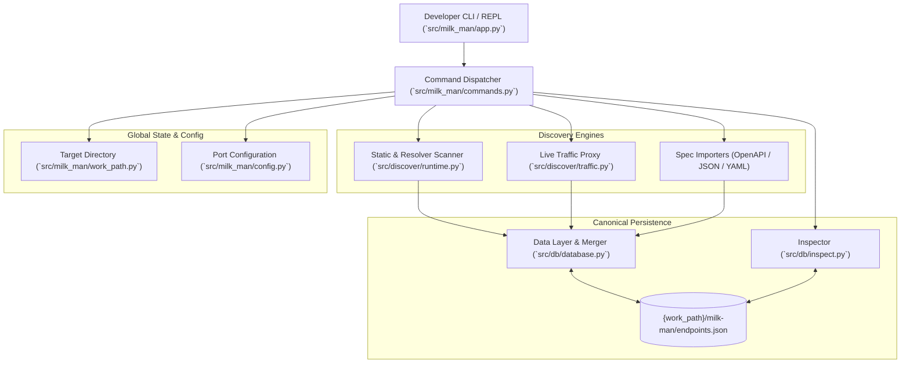

# AGENTS.md — AI Developer & Agent Integration Guide for Milk-Man

> **Target Audience:** All AI coding agents (and human engineers) implementing features, bug fixes, refactors, or extensions in the `milk-man` codebase.
> **Objective:** Ensure all features integrate flawlessly with existing architecture, data schemas, CLI UX, and test suites.

---

## 1. Project Mission & Core Concept

**Milk-Man** is a developer-facing CLI tool designed to discover, capture, inspect, and reconcile API endpoints for web applications (Django initially, with extensible framework support).



The tool unifies three views of an API:
1. **Declared API**: What is declared in source code routing (discovered via AST / resolver).
2. **Observed API**: What actually flows over HTTP during runtime (captured via FastAPI proxy).
3. **Documented API**: What is specified in contracts (imported from OpenAPI / Swagger).

---

## 2. Workspace & Environment Conventions

- **Python Version:** Python >= 3.14 (see `pyproject.toml:9`).
- **Package Manager & Runner:** `uv`.
- **Command Runner:** Always run tests and scripts using `uv run` (e.g., `uv run pytest`).
- **Dependencies:** Managed in `pyproject.toml`. Do not introduce heavyweight dependencies (like massive ORMs or external databases) without explicit need. Core libraries: `fastapi`, `httpx`, `python-multipart`, `rich`, `uvicorn`, `pytest`.

### Essential Commands
```bash
# Run the complete test suite
uv run pytest

# Run a specific test file with verbose output
uv run pytest tests/test_database.py -v

# Launch interactive REPL locally
uv run milk-man
```

---

## 3. Architecture & Repository Layout

```
milk-man/
├── pyproject.toml              # Project metadata & dependencies (uv build backend)
├── AGENTS.md                   # This integration guide
├── README.md                   # User documentation
├── src/
│   ├── milk_man/               # Core application package
│   │   ├── __init__.py         # CLI entry point (`main()`)
│   │   ├── app.py              # Interactive Rich REPL & input tokenizer
│   │   ├── commands.py         # Command dispatcher & help texts
│   │   ├── config.py           # Config state (client target port)
│   │   └── work_path.py        # Active target project directory & venv resolver
│   ├── discover/               # API discovery & capture layer
│   │   ├── runtime.py          # Django URL resolver & AST scanner
│   │   ├── scripts.py          # Standalone python scripts executed in target venv
│   │   └── traffic.py          # FastAPI reverse proxy capturing live HTTP traffic
│   ├── db/                     # Data persistence & query layer
│   │   ├── database.py         # JSON storage, merging, & deduplication logic
│   │   └── inspect.py          # Formatted query & retrieval for REPL
│   └── sender/                 # (Planned) HTTP request execution & test sender
└── tests/                      # Pytest suite with isolated fixtures
    ├── conftest.py             # Shared fixtures (fake_project, seed_endpoints)
    ├── test_app.py
    ├── test_config.py
    ├── test_database.py
    ├── test_inspect.py
    └── test_work_path.py
```

### Critical Packaging Note for AI Agents
Currently, `src/` contains three top-level packages: `milk_man`, `db`, and `discover`.
- Imports currently use top-level names: `from db.database import ...` and `from discover.runtime import ...`.
- In `pyproject.toml`, `uv_build` by default only bundles `milk_man`. If refactoring or packaging for distribution, either add `__init__.py` files and configure `[tool.uv.build]` packages, or maintain consistent import conventions across `src/`.

---

## 4. The Canonical Data Contract (`endpoints.json`)

All features that create, update, or read endpoints **MUST** adhere strictly to the storage contract defined in `db/database.py`.

### 4.1 Storage Location Rule
> [!IMPORTANT]
> The database file is **NEVER** stored directly at the Milk-Man repository root!  
> It is stored relative to the active target workspace directory:  
> `Path(work_path.path) / "milk-man" / "endpoints.json"`  
> Always resolve paths dynamically through `work_path.path`.

### 4.2 Canonical Endpoint Schema
Each record in `endpoints.json` is a JSON object conforming strictly to this structure:

```python
{
    "route": str,  # Normalized route (e.g. "/customer/categories/")
    "method": str
    | None,  # Uppercase HTTP method: "GET", "POST", etc., or None if unspecified
    "body": dict,  # Request schema, query parameters, form keys, or payload structure
    "observed_by": {
        "source_code": bool,  # True if discovered through AST or runtime code scan
        "live_traffic": bool,  # True if captured through reverse proxy
        "imported": bool,  # True if imported from OpenAPI/Swagger or external schema
    },
    "response_body": str | None,  # Serialized sample or schema of response body
    "response_status": int
    | None,  # Expected or observed HTTP status code (e.g. 200, 201)
}
```

### 4.3 Route & Method Normalization
- **Routes:** Handled via `_route_key(route)`. Strips leading and trailing slashes and guarantees a leading slash (unless root `"/"`).
- **Methods:** Handled via `_method_key(method)`. Returns uppercase (e.g. `"GET"`) or `None`.
- **Identity:** An endpoint is uniquely identified by `(_route_key(route), _method_key(method))`.
- **Methodless Merging:** When an endpoint is discovered via code scanning without a method (`method=None`), and later observed via live traffic with `method="GET"`, the deduplication logic in `database.py` merges the records into the method-specific endpoint.

### 4.4 Data Access Rules
Do **not** implement custom ad-hoc JSON file writing routines in new modules. Instead:
- Use `db.database.save_endpoints_to_file(routes, method=None)` for bulk route additions.
- Use `db.database.update_endpoint(route, **updates)` for updating endpoint details (such as observed traffic, response status, payloads).
- Use `db.inspect.get_all()` or `db.inspect.get_details(route)` for read operations.

---

## 5. REPL & Command Dispatch Integration

When adding new commands or flags, update the complete REPL lifecycle:

### 5.1 Step 1: Input Parsing (`src/milk_man/app.py`)
- `execute_request(request: str)` splits user input via `shlex.split`.
- Strips leading slashes (`/inspect` and `inspect` behave identically).
- Handles natural language aliases if helpful (e.g., `scan this project` -> `scan django`).

### 5.2 Step 2: Command Dispatch (`src/milk_man/commands.py`)
- Function: `main(command: str, args: list[str]) -> str | list[str] | dict | None`.
- Respect return type contracts handled by `app.py`:
  - `list[str]`: Rendered line-by-line with clean spacing.
  - `dict`: Formatted using `rich.pretty.Pretty` with indent guides.
  - `str`: Displayed directly (`markup=False` to prevent bbcode/rich collision).
  - `None`: Silent success.
  - Errors: Return a string starting with `"Error: <details>"`.

### 5.3 Step 3: Help Documentation (`src/milk_man/commands.py`)
- Update `help` in `commands.py`:
  - Add the new command to the default help message (`commands.py:89-98`).
  - Add a dedicated subcommand help block (`elif args[0].lower() == "<new_command>": ...`).

---

## 6. Developing New Features: Playbooks

### Playbook A: Adding an OpenAPI / Swagger Importer
1. **Module Placement:** Create `src/db/openapi.py` (or `src/discover/openapi.py`).
2. **Requirements:**
   - Support JSON and YAML formats (OpenAPI 3.0, 3.1).
   - Iterate over `paths` and operations (`GET`, `POST`, `PUT`, `DELETE`, `PATCH`, `OPTIONS`, `HEAD`).
   - Extract request body schema and lowest 2xx response status code + response body schema.
   - Resolve internal schema `$ref` references.
3. **Persistence:**
   - Save directly into `<work_path>/milk-man/endpoints.json` using `db.database`.
   - Set `"observed_by": {"source_code": False, "live_traffic": False, "imported": True}`.
   - Run deduplication against existing entries.
4. **Command Wiring:**
   - Add `import <file_path>` or `openapi <file_path>` to `commands.py`.

### Playbook B: Implementing the `compare` Command
1. **Goal:** Compare routes across `observed_by.source_code`, `observed_by.live_traffic`, and `observed_by.imported`.
2. **Classification:**
   - **Undocumented:** Endpoints seen in `live_traffic` but absent from `source_code` or `imported`.
   - **Untested / Inactive:** Endpoints present in `source_code` or `imported` with `live_traffic == False`.
   - **Mismatches:** Status code differences or unexpected request parameters.
3. **Output:** Return a formatted Rich string or list of categorized endpoint summaries.

### Playbook C: Implementing the `sender` Module
1. **Module Placement:** `src/sender/` (e.g., `src/sender/client.py`).
2. **Target Resolution:** Use `milk_man.config.get_client_port()` to target `http://127.0.0.1:{client_port}`.
3. **Execution:** Use `httpx.AsyncClient` or synchronous `httpx.Client` to replay saved requests or probe endpoints.
4. **Result Recording:** Feed response status and body back into `db.database.update_endpoint()`.

### Playbook D: Adding Framework Scanners (e.g., FastAPI, Flask)
1. **Module Placement:** `src/discover/` (e.g., `src/discover/fastapi.py`).
2. **Target Environment Execution:** Always use `work_path.get_exec_path()` to invoke the target project's Python virtual environment (`.venv/bin/python`) rather than the host CLI environment.
3. **Scanning Strategy:**
   - Strategy 1: Runtime inspection via subprocess script.
   - Strategy 2: Static AST fallback (like `DJANGO_AST_SEARCH` in `src/discover/scripts.py`).
   - If strategy 1 succeeds, break early to avoid running the fallback unnecessarily.
4. **Output:** Return a list of route strings and pass to `db.database.save_endpoints_to_file()`.

---

## 7. Quality Standards & Python 3 Conventions

### 7.1 Python Syntax & Typing Rules
- **Type Annotations:** All new functions and public methods must have complete type hints (e.g., `def run(path: Path) -> list[str]:`).
- **Union Types:** Use modern union syntax `str | None` instead of `Optional[str]` or `Union[str, None]`.
- **File Encodings:** Always specify `encoding="utf-8"` when calling `.open()` or `read_text()`.
- **String Formatting:** Use f-strings for error messages and output formatting.

### 7.2 Safety & Defensive Programming
- **Binary Payloads:** In the proxy or HTTP handlers, never blindly call `.decode("utf-8")` without `errors="replace"` or binary guards (to prevent `UnicodeDecodeError` on images/files).
- **Subprocesses:** Always pass `check=True` (or handle `CalledProcessError`), set explicit `timeout`s, and capture both `stdout` and `stderr`.
- **Unbound Variables:** Ensure all loops or try-blocks guarantee variable assignment before referencing (e.g., initialize `result = None` before subprocess execution).

---

## 8. Testing Guidelines & Fixtures

The test suite must maintain high reliability and sub-second execution speed.

### 8.1 The Fixture Contract (`tests/conftest.py`)
Never touch real files or the current directory in tests! Always use the existing fixtures:

```python
def test_my_feature(fake_project, seed_endpoints):
    # 1. Arrange: seed data into fake_project/milk-man/endpoints.json
    seed_endpoints([{"route": "/api/users", "method": "GET", "body": {}}])

    # 2. Act: Call your function
    result = get_details("/api/users")

    # 3. Assert: Validate return types and data integrity
    assert result is not None
    assert result["method"] == "GET"
```

### 8.2 Testing Checklist for Every Pull Request / Feature
- [ ] Unit tests for new logic (use `@pytest.mark.parametrize` for input variations and edge cases).
- [ ] Test the empty state (no file, empty directory, missing endpoint).
- [ ] Test return types and error strings (`assert isinstance(...)`).
- [ ] If adding a command, add tests in `tests/test_app.py` or a new `tests/test_commands.py`.
- [ ] Verify that `uv run pytest` runs cleanly with 0 failures before completing work.
