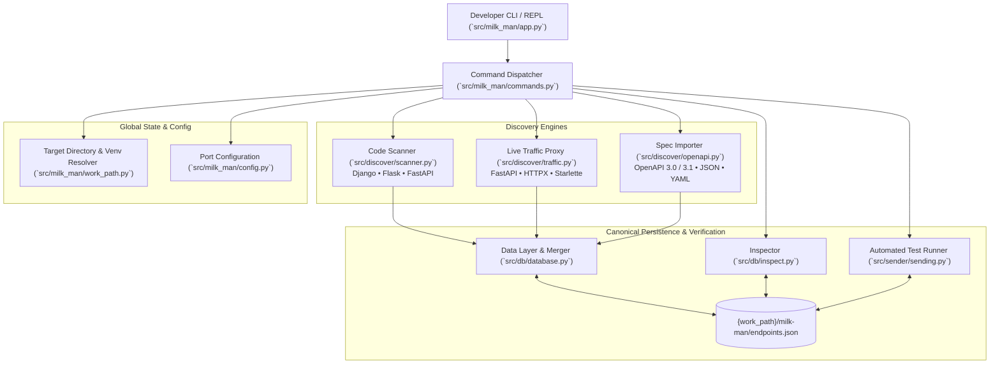

# 🥛 Milk-Man

<p align="center">
  <strong>The developer-first CLI to discover, capture, inspect, and reconcile web APIs.</strong>
</p>

<p align="center">
  <a href="https://github.com/lenhad123654/milk-man/actions"></a>
  <a href="https://www.python.org/downloads/"></a>
  <a href="https://github.com/astral-sh/uv"></a>
  <a href="#"></a>
  <a href="./LICENSE"></a>
</p>

---

## 💡 The Problem & The Solution

In modern software development, web APIs live in three fragmented realities:

1. **Declared API:** What routes are registered in application source code (Django, Flask, FastAPI).
2. **Observed API:** What requests actually travel across the wire at runtime with live payloads and HTTP statuses.
3. **Documented API:** What contracts are written in OpenAPI / Swagger specifications.

These three views constantly drift apart. Developers build endpoints that remain undocumented, schemas change without contract updates, and dead routes clutter codebases.

**Milk-Man** unites all three perspectives into a single canonical source of truth (`milk-man/endpoints.json`). It lets you scan codebases, proxy real HTTP traffic, import OpenAPI contracts, inspect endpoint state in an interactive REPL, and instantly scaffold and run automated API tests.

```text
       Declared API                Observed API               Documented API
  (Django / Flask / FastAPI)     (Live HTTP Traffic)      (OpenAPI 3.0 / 3.1 Specs)
               │                          │                           │
               └────────────────────── milk-man ──────────────────────┘
                                          │
                                   endpoints.json
                                          │
                     ┌────────────────────┴────────────────────┐
                     ▼                                         ▼
           Interactive REPL Inspector                  Automated Test Runner
            (`inspect`, `inspect details`)             (`test`, `test make`)
```

---

## ✨ Features

- 🔍 **Multi-Framework Route Discovery:** Static AST and runtime resolver scanning for **Django**, **Flask**, and **FastAPI** applications without manual configuration.
- 🚦 **Zero-Config Traffic Reverse Proxy:** FastAPI/HTTPX-powered local reverse proxy that captures real payloads, headers, and status codes while stripping hop-by-hop headers to prevent upstream host conflicts.
- 📜 **Full OpenAPI 3.0 & 3.1 Spec Importer:** Imports JSON or YAML OpenAPI contracts, recursively resolves local `$ref` pointers, and extracts request and response schemas.
- 🧬 **Intelligent Schema Deduplication:** Merges declared routes with live traffic observations and spec contracts without clobbering existing metadata.
- 🧪 **Built-in Automated HTTP Tester:** Generate automated test suites directly from your endpoint database (`test make`) and run assertions (`test [name]`) with rich pass/fail reporting.
- 💻 **Cross-Platform Native Support:** Built from the ground up for seamless operation across **Linux**, **macOS**, and **Windows** (including platform-specific virtualenv resolution and socket process inspection).
- 🎨 **Interactive Rich REPL:** Polished command-line shell with syntax highlighting, pretty-printed inspection trees, and natural language aliases.

---

## 🚀 Quickstart

### 1. Installation

Install globally or as a developer tool with [`uv`](https://docs.astral.sh/uv/):

```bash
uv tool install milk-man
```

Or install with `pip`:

```bash
pip install milk-man
```

For local development or cloning the repository:

```bash
git clone https://github.com/lenhad123654/milk-man.git
cd milk-man
uv run milk-man
```

---

### 2. Basic Workflow

Navigate to the target project directory and launch Milk-Man:

```bash
cd my-web-app
milk-man
```

You are greeted by the interactive REPL:

```text
Milk man
Discover and understand the APIs in your project.
Try: scan this project  ·  inspect  ·  traffic status  ·  help

milk-man › 
```

#### Step 1: Scan Source Code
Automatically extract declared routes from your framework:

```text
milk-man › scan django
  /api/users/
  /api/auth/login/
  /health/
```

*(You can also scan Flask or FastAPI apps with `scan flask` or `scan fastapi`.)*

#### Step 2: Import an OpenAPI Contract
Merge your OpenAPI documentation into the endpoint database:

```text
milk-man › import openapi.yaml
  /api/users/
  /api/products/
```

#### Step 3: Capture Live Traffic
Start the transparent reverse proxy (default listening on port `12345`, forwarding to your app on port `8000`):

```text
milk-man › traffic open 8000
Traffic proxy opened on port 12345, forwarding to port 8000.
```

Direct your frontend, test client, or curl requests to `http://127.0.0.1:12345`. Every request and response payload is recorded and merged into `endpoints.json`.

Check proxy health or stop it at any time:

```text
milk-man › traffic status
Proxy is open

milk-man › traffic close
Traffic proxy closed.
```

#### Step 4: Inspect Unified Endpoints
List all endpoints or view detailed payload schemas and observation sources:

```text
milk-man › inspect
  '/api/users' [GET]
  '/api/users' [POST]
  '/health' [GET]

milk-man › inspect details /api/users
```

```json
{
    "route": "/api/users",
    "method": "POST",
    "body": {
        "name": "Ada Lovelace",
        "email": "ada@example.com"
    },
    "observed_by": {
        "source_code": true,
        "live_traffic": true,
        "imported": true
    },
    "response_body": {
        "id": 1,
        "status": "created"
    },
    "response_status": 201
}
```

#### Step 5: Generate & Run API Tests
Automatically scaffold test cases from your observed endpoints and execute assertions:

```text
milk-man › test make
Test templates created in /path/to/my-web-app/milk-man/tester.json. Please edit them as needed.

milk-man › test
PASSED 'api-users-post'. Response matched expected result.
PASSED 'health-get'. Response matched expected result.
```

---

## 📖 Command Reference

| Command | Arguments | Description |
| :--- | :--- | :--- |
| **`scan`** | `[django \| flask \| fastapi] [file]` | Discovers routes from project source code (Django resolver/AST, Flask, or FastAPI). |
| **`import`** *(or `openapi`)* | `<file>` | Imports OpenAPI 3.0/3.1 JSON or YAML specification and extracts schemas. |
| **`traffic open`** | `[client_port]` | Starts the reverse proxy on port `12345` and forwards requests to the target port. |
| **`traffic status`** | — | Displays whether the background traffic proxy is currently listening. |
| **`traffic close`** | — | Stops the traffic proxy and releases the port. |
| **`inspect`** *(or `inspect all`)* | — | Lists all discovered endpoints with HTTP methods and routes. |
| **`inspect details`** | `<route>` | Displays the complete JSON record (payloads, status, sources) for a route. |
| **`test`** | — | Runs all test definitions configured in `milk-man/tester.json`. |
| **`test`** | `<name>` | Runs a specific named test case. |
| **`test make`** | — | Generates `milk-man/tester.json` starter templates from `endpoints.json`. |
| **`path`** | — | Prints the active project directory path. |
| **`path`** | `<directory>` | Switches the active project directory (supports `~` expansion). |
| **`set port`** | `<port>` | Configures the default target API port (default: `8000`). |
| **`help`** | `[command]` | Displays interactive help reference or details for a specific command. |
| **`exit`** *(or `quit`)* | — | Exits the interactive Milk-Man REPL. |

---

## 🗄️ The Canonical Data Contract (`endpoints.json`)

All features write to and read from a single canonical database stored in the target project:
`<target-project>/milk-man/endpoints.json`

```json
[
  {
    "route": "/api/v1/users",
    "method": "POST",
    "body": {
      "username": "string",
      "email": "string"
    },
    "observed_by": {
      "source_code": true,
      "live_traffic": true,
      "imported": true
    },
    "response_body": {
      "id": 42,
      "username": "ada"
    },
    "response_status": 201
  }
]
```

### Route & Method Normalization
- **Unique Identification:** An endpoint is uniquely keyed by `(normalized_route, method)`.
- **Methodless Merging:** A route discovered via static scanning without a method (`method: None`) is automatically merged into method-specific entries (`GET`, `POST`, etc.) when observed in live traffic or specs.
- **Traceability:** The `observed_by` flags track exactly where each piece of information originated.

---

## 🧪 Automated Testing with `tester.json`

Milk-Man includes a lightweight testing engine built for API validation. The test configuration is stored at `<target-project>/milk-man/tester.json`.

```json
{
  "create-user": {
    "url": "http://127.0.0.1:8000/api/users/",
    "method": "POST",
    "headers": {
      "Content-Type": "application/x-www-form-urlencoded"
    },
    "body": {
      "name": "Ada",
      "email": "ada@example.com"
    },
    "expected": 201
  },
  "health-check": {
    "url": "http://127.0.0.1:8000/health/",
    "method": "GET",
    "expected": {
      "status_code": 200,
      "body": {
        "status": "ok"
      }
    }
  }
}
```

- **Status Check:** Set `"expected": <int>` to assert status code.
- **Body Validation:** Set `"expected": { "status_code": <int>, "body": { ... } }` for exact JSON response validation.

For advanced usage and headers, see [TESTER.md](./TESTER.md).

---

## 🏛️ Architecture & System Design



### Cross-Platform Engineering
Milk-Man is designed to work identically across Windows, macOS, and Linux:
- **Virtualenv Resolution:** Dynamically inspects `.venv/bin/python` on Unix and `.venv\Scripts\python.exe` on Windows.
- **Proxy Socket Inspection:** Automatically utilizes `ss` on Linux, `lsof` on macOS, and `netstat` on Windows, coupled with background `.proxy.pid` tracking.
- **Path Escaping:** Tokenizer guards against backslash stripping on Windows shells while preserving POSIX ergonomics on macOS/Linux.

---

## ⚙️ Environment Variables

| Variable | Default | Purpose |
| :--- | :--- | :--- |
| `MILK_MAN_PROXY_PORT` | `12345` | Port on which the Milk-Man reverse proxy listens. |
| `MILK_MAN_CLIENT_PORT` | `8000` | Target service port to which live requests are forwarded. |

---

## 🛠️ Development & Contributing

Milk-Man requires Python 3.10+ and uses [`uv`](https://docs.astral.sh/uv/) for high-speed dependency resolution and packaging:

```bash
# Clone the repository
git clone https://github.com/lenhad123654/milk-man.git
cd milk-man

# Install dependencies and sync virtual environment
uv sync

# Run the complete test suite (93 unit and integration tests)
uv run pytest

# Run tests with verbose output
uv run pytest -v

# Build the distributable wheel and source archive
uv build
```

Read [AGENTS.md](./AGENTS.md) for architectural guidelines, canonical data schemas, and integration patterns.

---

## 📄 License

Milk-Man is open-source software licensed under the [MIT License](./LICENSE).
