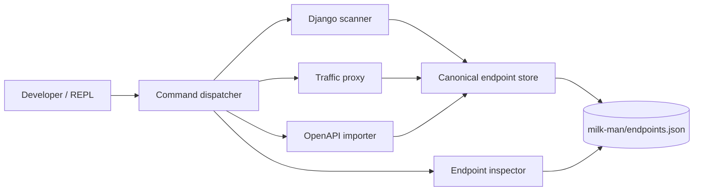

# Milk-Man

Milk-Man is an interactive CLI for discovering, inspecting, and reconciling
web APIs. It brings together routes declared in Django source code, requests
observed through a local traffic proxy, and endpoints documented in OpenAPI
3.0 or 3.1 specifications.

```text
  Declared API       Observed API       Documented API
       │                  │                   │
       └────────────── milk-man ──────────────┘
                          │
                 endpoints.json
```

## Features

- Scan Django URL configuration for declared endpoints.
- Capture live requests and responses with a local reverse proxy.
- Import OpenAPI 3.0 and 3.1 JSON or YAML specifications.
- Merge discoveries while retaining their source and response details.
- Explore the results from a Rich-powered interactive REPL.

## Installation

Install the published package with [uv](https://docs.astral.sh/uv/):

```bash
uv tool install milk-man
```

For local development, clone the repository and run the CLI with uv:

```bash
git clone https://github.com/lenhad123654/milk-man.git
cd milk-man
uv run milk-man
```

## Quickstart

Run Milk-Man from the Django project you want to inspect:

```bash
cd my-django-project
milk-man
```

Then use the REPL to discover and inspect endpoints:

```text
scan django
inspect all
inspect details /api/users/
```

Milk-Man stores its canonical endpoint data at
`<target-project>/milk-man/endpoints.json`. The traffic proxy listens on
`127.0.0.1:12345` and forwards to the target service on port `8000` by
default. Set `MILK_MAN_PROXY_PORT` to change the proxy port.

## Command reference

| Command | Description |
| --- | --- |
| `scan django` | Discover routes from the Django project. |
| `import openapi.yaml` | Import an OpenAPI JSON or YAML specification. |
| `traffic open [client_port]` | Open the traffic proxy and forward requests to the target service. |
| `traffic status` | Show whether the traffic proxy is running. |
| `traffic close` | Stop the traffic proxy. |
| `inspect all` | List all discovered endpoints. |
| `inspect details <route>` | Show the stored details for one route. |
| `set port <port>` | Set the target service port for the current session. |
| `help` | Show command and subcommand help. |

The `import` command also accepts the `openapi` alias:

```text
openapi path/to/openapi.yaml
```

## Architecture



Milk-Man executes scanner code in the target project's environment and proxies
requests to the target service. Use it with projects and services you trust.

## Development

The project requires Python 3.10 or newer and uses uv for dependency and
command management:

```bash
uv sync
uv run pytest
uv build
```

Contributions should include focused tests for new behavior and keep the
canonical endpoint schema documented in `AGENTS.md` intact.

## License

Milk-Man is released under the [MIT License](./LICENSE).
