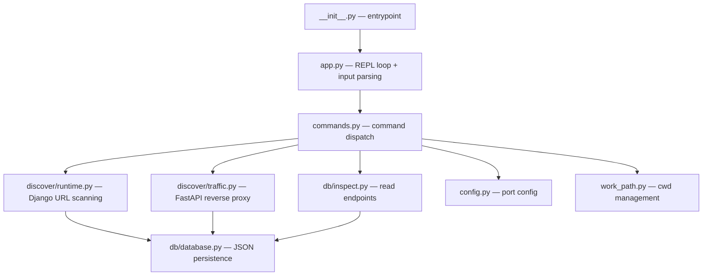
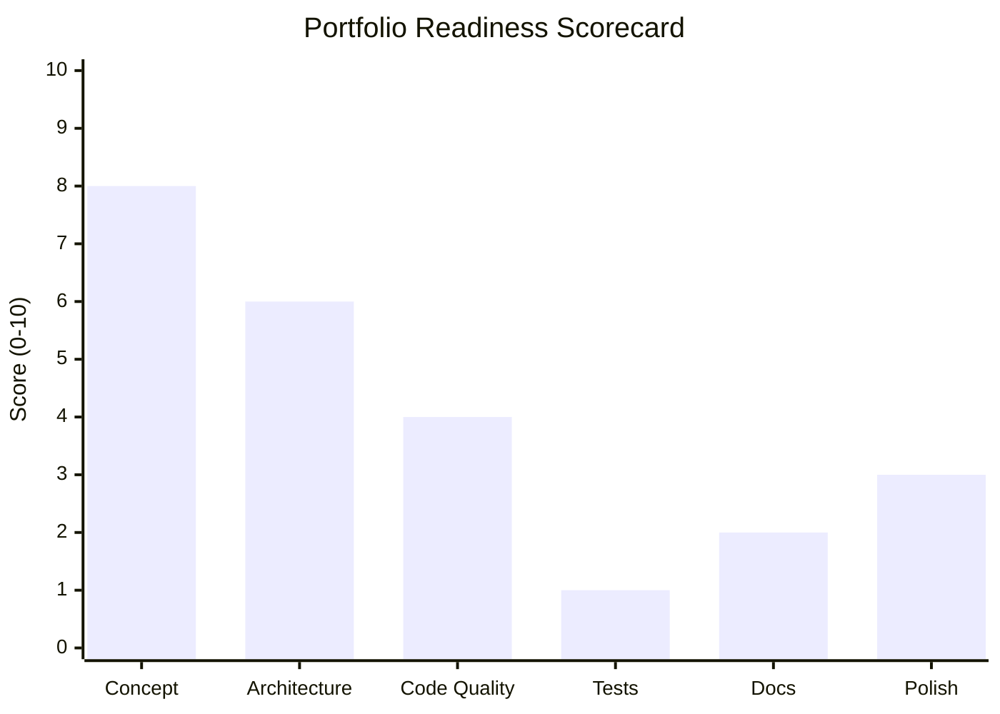

# Milk-Man — Code Review & Portfolio Assessment

**Review date:** 2026-11-02  
**Project:** [milk-man](/home/lenhad/Documents/Stuff/milk-man) — A CLI tool for discovering, proxying, and inspecting Django API endpoints  
**Lines of code:** ~800 across 13 Python source files  
**Test coverage:** 1 test file, 1 test function

---

## What the Project Does

Milk-man is a developer-facing CLI tool that:

1. **Scans** a Django project's URL configuration (via `manage.py` resolver or AST parsing of `urls.py`) to discover API endpoints
2. **Proxies** live HTTP traffic through a FastAPI/uvicorn reverse proxy, recording request/response data
3. **Inspects** saved endpoint data from a local JSON "database" (`endpoints.json`)
4. **Persists** endpoint metadata including route, HTTP method, request/response bodies, and how each endpoint was discovered (source code scan vs. live traffic)

It runs as an interactive REPL with Rich-formatted output.

---

## Architecture Overview

The structure is logical — discovery, database, and app concerns are separated into packages. That said, there are some architectural issues worth noting below.

---

## Strengths

### Things done well

- **Interesting concept.** An API discovery + traffic recording tool is a genuinely useful idea. It shows systems thinking and awareness of developer tooling needs.
- **Two scanning strategies.** The fallback from Django's runtime resolver to AST-based parsing ([`runtime.py`](file:///home/lenhad/Documents/Stuff/milk-man/src/discover/runtime.py#L40-L55)) is clever and shows good problem-solving instinct.
- **Port validation.** [`config.py`](file:///home/lenhad/Documents/Stuff/milk-man/src/milk_man/config.py#L12-14) validates port range — small but good practice.
- **Deduplication logic.** [`database.py`](file:///home/lenhad/Documents/Stuff/milk-man/src/db/database.py#L51-93) has thoughtful merge/dedup logic for handling the same route discovered via different methods.
- **Clean REPL UX.** The Rich-powered input loop with natural-language aliases (`scan this project`) is a nice touch.
- **Proper process lifecycle management.** The proxy startup/shutdown with PID tracking in [`traffic.py`](file:///home/lenhad/Documents/Stuff/milk-man/src/discover/traffic.py#L31-78) shows attention to detail.

---

## Issues Found

### 🔴 Bugs

| # | File | Line(s) | Issue |
|---|------|---------|-------|
| 1 | [`app.py`](file:///home/lenhad/Documents/Stuff/milk-man/src/milk_man/app.py#L42) | 42 | **Invalid except syntax.** `except EOFError, KeyboardInterrupt:` is Python 2 syntax. In Python 3 this is a `SyntaxError`. Must be `except (EOFError, KeyboardInterrupt):` |
| 2 | [`commands.py`](file:///home/lenhad/Documents/Stuff/milk-man/src/milk_man/commands.py#L35) | 35 | **Same bug.** `except IndexError, ValueError:` — Python 2 tuple-catch syntax. |
| 3 | [`commands.py`](file:///home/lenhad/Documents/Stuff/milk-man/src/milk_man/commands.py#L84) | 84 | **Same bug again.** `except IndexError, ValueError:` |
| 4 | [`runtime.py`](file:///home/lenhad/Documents/Stuff/milk-man/src/discover/runtime.py#L68) | 68 | **Returns a tuple instead of a string on error.** `return "Error running...", e.stderr` returns `("Error...", stderr)` not a formatted string. Should use an f-string. |
| 5 | [`runtime.py`](file:///home/lenhad/Documents/Stuff/milk-man/src/discover/runtime.py#L70-71) | 70-71 | **`result` may be unbound.** If the first `subprocess.run` raises and `i == 0`, the loop `continue`s. If the second also raises, `result` is never assigned but is used on line 71. |
| 6 | [`runtime.py`](file:///home/lenhad/Documents/Stuff/milk-man/src/discover/runtime.py#L38) | 38 | **`IndexError` crash if no `urls.py` found.** `list(...)[0]` will raise `IndexError` with no useful message if the project has no `urls.py`. |
| 7 | [`traffic.py`](file:///home/lenhad/Documents/Stuff/milk-man/src/discover/traffic.py#L180) | 176-181 | **`UnicodeDecodeError` risk.** `body.decode("utf-8")` and `response_body.decode("utf-8")` will crash on binary payloads (file uploads, images). |

> [!CAUTION]
> Bug #1 means the app **cannot actually run** on Python 3.14 (or any Python 3.x). This is a show-stopper.

### 🟡 Design / Code Quality Issues

| # | Area | Issue |
|---|------|-------|
| 8 | **Empty files** | [`adapters.py`](file:///home/lenhad/Documents/Stuff/milk-man/src/discover/adapters.py), [`endpoints.py`](file:///home/lenhad/Documents/Stuff/milk-man/src/discover/endpoints.py), [`reconcile.py`](file:///home/lenhad/Documents/Stuff/milk-man/src/discover/reconcile.py), and [`openapi.py`](file:///home/lenhad/Documents/Stuff/milk-man/src/db/openapi.py) are completely empty. Shipping empty placeholder files looks unfinished. |
| 9 | **No `__init__.py`** in `src/db/` and `src/discover/` | These packages work only because of implicit namespace packages or `--app-dir` tricks. Fragile. |
| 10 | **Global mutable state** | [`work_path.py`](file:///home/lenhad/Documents/Stuff/milk-man/src/milk_man/work_path.py#L5) and [`config.py`](file:///home/lenhad/Documents/Stuff/milk-man/src/milk_man/config.py#L5) use module-level globals mutated via functions. This makes testing hard and creates hidden coupling. |
| 11 | **No type hints on `django_scan()`** | [`runtime.py`](file:///home/lenhad/Documents/Stuff/milk-man/src/discover/runtime.py#L7) — return type is `list[str] | tuple[str, str]` but has no annotation. |
| 12 | **Inline Python code as strings** | [`runtime.py`](file:///home/lenhad/Documents/Stuff/milk-man/src/discover/runtime.py#L9-37) — the subprocess Python scripts embedded as multi-line strings are hard to read, debug, and maintain. Consider separate `.py` script files. |
| 13 | **`app_choices` return type is inconsistent** | [`traffic.py`](file:///home/lenhad/Documents/Stuff/milk-man/src/discover/traffic.py#L96) — declared as returning `FastAPI` but returns `str` for `"status"`. |
| 14 | **No docstrings anywhere** | Not a single function or module has a docstring. |
| 15 | **`venv` hardcoded** | [`work_path.py`](file:///home/lenhad/Documents/Stuff/milk-man/src/milk_man/work_path.py#L21) only checks `venv/bin/python`, missing `.venv/` (which is what uv creates by default). |
| 16 | **JSON file as database** | Fine for a prototype, but concurrent proxy requests writing to the same `endpoints.json` will race. No file locking. |
| 17 | **`pyproject.toml` description** | `"Man with Milk"` — not professional for a portfolio piece. |

### 🟢 Minor / Style

- Several typos in comments: `"previus"` ([`commands.py:40`](file:///home/lenhad/Documents/Stuff/milk-man/src/milk_man/commands.py#L40)), `"trys"` ([`runtime.py:41,43`](file:///home/lenhad/Documents/Stuff/milk-man/src/discover/runtime.py#L41))
- `get_exec_path()` missing return type annotation
- `inspect.py` uses `open()` directly instead of `Path.read_text()` (inconsistent with `database.py`)

---

## Test Coverage

> [!WARNING]
> There is **1 test** covering **1 function** (`execute_request` input normalization). Nothing else is tested.

### What's missing:
- `commands.py` dispatch logic (the core of the app)
- `database.py` merge/dedup logic (the most complex code in the project — ~170 lines untested)
- `traffic.py` proxy behavior
- `runtime.py` Django scanning
- `config.py` port validation
- Error paths and edge cases everywhere

For a portfolio project, you should aim for at least **20-30 tests** covering the core logic. The `database.py` merge functions alone deserve 10+ test cases.

---

## Security Considerations

| Concern | Severity | Details |
|---------|----------|---------|
| **Subprocess with user-controlled paths** | Medium | `work_path.change_path()` accepts arbitrary user input passed to `os.chdir()`. The subprocess in `runtime.py` runs Python from whatever venv is found in that directory. |
| **No input sanitization on proxy** | Low | The proxy forwards all headers and body bytes to the target. Acceptable for a local dev tool, but worth noting. |
| **`ss` and `ps` system calls** | Low | Used for process detection — fine for local dev, but won't work on macOS/Windows. |
| **PID-based process management** | Low | `os.kill()` on discovered PIDs — race conditions possible but acceptable for dev tooling. |

None of these are dealbreakers for a **local developer tool**, but they should be documented.

---

## Portfolio Readiness Assessment

### Current State: 🔴 Not Ready

### What an employer/reviewer would notice:

| ✅ Positives | ❌ Red Flags |
|-------------|-------------|
| Interesting, original idea | Syntax errors that prevent the app from running |
| Shows understanding of subprocesses, async, proxying | 4 empty placeholder files committed |
| Clean REPL experience | Almost zero tests |
| Thoughtful data merging logic | No docstrings or documentation |
| Modern tooling (uv, FastAPI, Rich) | `"Man with Milk"` as project description |
| | README is minimal — no screenshots, examples, or "why" |

---

## Recommendations — Road to Portfolio-Ready

### Must-Fix Before Publishing (Priority 1)

1. **Fix the Python 2 `except` syntax** in all 3 locations — this is a crash-on-import bug
2. **Fix `runtime.py` tuple-return bug** and unbound `result` variable
3. **Delete empty files** (`adapters.py`, `endpoints.py`, `reconcile.py`, `openapi.py`) or add real content
4. **Add `__init__.py`** to `src/db/` and `src/discover/`
5. **Write at minimum 15-20 tests** — focus on `database.py` merge logic and `commands.py` dispatch
6. **Handle `UnicodeDecodeError`** in the proxy for binary payloads

### Should-Fix Before Publishing (Priority 2)

7. **Write a real README** — include: what it does, why, a GIF/screenshot of the REPL, installation steps, usage examples, architecture diagram
8. **Add docstrings** to all public functions
9. **Add type annotations** to `django_scan()`, `get_exec_path()`, `app_choices()`
10. **Fix the project description** in `pyproject.toml` to something professional
11. **Add `.venv` support** alongside `venv` in `get_exec_path()`
12. **Extract inline Python scripts** from `runtime.py` into standalone files
13. **Add a `LICENSE` file**

### Nice-to-Have (Priority 3)

14. Add a `--version` flag and proper CLI argument parsing (e.g., with `click` or `typer`)
15. Add a `Makefile` or `justfile` with dev commands
16. Add CI via GitHub Actions (lint + test)
17. Add `py.typed` marker and run `mypy` clean
18. Consider SQLite instead of JSON for the endpoint store (solves concurrency)

---

## Bottom Line

> [!IMPORTANT]
> **Don't publish it yet.** The concept is strong and shows genuine engineering thinking, but the current state has bugs that prevent it from running and almost no tests. An interviewer who clones this and tries to run it will hit a `SyntaxError` immediately.
> 
> **Spend a weekend fixing Priority 1 + 2 items**, and this becomes a solid portfolio piece that demonstrates: systems programming (subprocesses, process lifecycle), async networking (FastAPI proxy), developer tooling UX (Rich REPL), and data management (merge/dedup logic). That's a compelling story.

